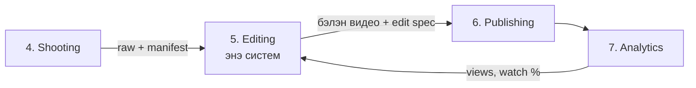

## Background

Сурагчдын testimonial бичлэгийг гараар засварлахад нэг видео дээр хэдэн цаг зарцуулдаг. Ярилцлага авагчийн дуу, давтан хэлсэн хэсэг, caption, хөгжим зэргийг видео бүр дээр дахин хийдэг.

Би Pinecone-ийн reel-үүдийн дүрэм, reference-ийг тодорхойлж, AI-аар raw бичлэгээс бэлэн reel хүртэл автоматаар засварладаг систем хийсэн. Энэ систем нь Content Factory-ийн **Editing (5)** хэсэг бөгөөд би энэ хэсгийг хариуцдаг.

## Content Factory дахь байр суурь

Editing нь Shooting-ээс raw бичлэг авч, Publishing руу бэлэн видео өгнө. Analytics-ийн үр дүнгээр Editing-ийн дүрмүүд сайжирна.

## Хийсэн ажил

**Reference & дүрэм.** Pinecone аккаунтын reel-үүдийг audit хийж, 5 seated-testimonial reel-ийг (DfEm-d-iLUz, De_gAILE-kX, DbSWjRPjlsR, DbVDbKTjTty, DbpRFI8D0D3) загвар болгосон. Тэдгээрээс хэмжсэн утгууд: hard cut, бичигдэж гарах асуултын карт, ducking-гүй тогтмол хөгжим, -14.2…-15.3 LUFS.

**Гаргасан видео:**

- 5 сурагчтай нийлмэл reel (3:56)
- 8 сурагчийн тус бүрийн reel: нэр, карттай clean хувилбар
- 8 сурагчийн caption + хөгжимтэй эцсийн хувилбар

**Шийдсэн асуудал:** хариулт дундуур тасрах, "Pinecone"-г ASR буруу сонсох, Ө/Ү үсэг өөр фонтоор гарах, нэр болон kicker наалдсан харагдах.

## Editing Rulebook

Миний тогтоосон, систем дагадаг дүрмүүд:

| Хэсэг | Дүрэм |
|---|---|
| Дуу | Ярилцлага авагчийн дуу байхгүй. Хариулт бүр бүрэн дуусаж байж тасарна |
| Бүтэц | Intro → q1 → q2 → q3 → q4. Хариулаагүй асуултыг алгасна |
| Шилжилт | Hard cut. Blur, bloom шилжилт хэрэглэхгүй |
| Асуулт | Хар карт дээр бичигдэж гарна, үсэг бүрт жинхэнэ товчлуурын дуу |
| Нэр | Intro дээр bold kinetic нэр, `PINECONE BOOTCAMP · СУРАГЧ` kicker-ээс 42px зайтай |
| Caption | GIP 57.5px, цагаан. Нэрээ хэлсэн мөрийг оруулахгүй. Цэг таслал, дүрэм шалгасан |
| Хөгжим | Funkorama (CC BY 4.0), тогтмол, -14.5 LUFS, яриа хөгжмөөс ~16.5 dB чанга |
| Брэнд | Зөөлөн шаргал logo, гөлгөр outro |

## How It Works

1. **Transcribe** — raw дууг `dash.pinecone.mn/reel` (Speechmatics) руу явуулж, үг бүрийн цагийг авна.
2. **Select** — асуулт болон хариултыг ялгаж EDL үүсгэнэ. Тасдах цэгийг үгийн хил дээрх хамгийн нам гүм 40ms руу автоматаар тааруулна (хариулт тасрахгүй).
3. **Assemble** — Remotion дээр нэр, карт, hard cut, logo, outro-той reel угсарна. Дуу бүрийг ижил түвшинд (-14.3 LUFS) тааруулна.
4. **Caption** — эцсийн edit-ийг дахин transcribe хийж, мэдэгдэж буй алдааг засна ("банканд", "ком", "2011 онд" → Pinecone). Эргэлзээтэй үгийг whisper-ээр давхар шалгана.
5. **Review** — сурагчийн нэр болон эргэлзээтэй caption мөрийг хүн батална. Энэ бол цорын ганц гар алхам.
6. **Mix** — хөгжим нэмж, loudness болон true peak-ийг (≤ -1 dBTP) тааруулна.

Шалгалт: тасдах цэг бүрийн дууны түвшин, still frame харьцуулалт, `ebur128` loudness хэмжилт файл бүр дээр.

## Interfaces

**Shooting-ээс авах:** raw mp4 + manifest (`video_id`, нэр кирилл үсгээр, асуултын жагсаалт, тэмдэглэл).

**Publishing руу өгөх:** edited mp4, clean mp4, caption текст, хөгжмийн attribution мөр, edit spec JSON.

**Analytics-аас авах:** `video_id` бүрийн views, 3s hold %, average watch %, shares, saves.

## Learning from Analytics

Видео бүрийн edit spec-ийг (урт, hook, хөгжим, caption style) хадгалж, Analytics-ийн metric-тэй `video_id`-аар холбоно. 7 хоног бүр харьцуулж, rulebook-ийн өөрчлөлтийг санал болгоно. Би баталсны дараа шинэ дүрэм хэрэгжинэ. Хангалттай өгөгдөл хуримтлагдвал жижиг өөрчлөлтийг автоматаар хийнэ.

## Next Steps

- Төслийг `/tmp`-ээс repo болон server руу шилжүүлэх (macOS түр файлыг устгасан тохиолдол гарсан)
- Transcript-ийг browser-оор биш API-аар авах
- Shooting-ийн manifest болон тусдаа audio channel-ийг стандарт болгох
- Content Factory app-д Editing station-ий статус гаргах

## Non Goals

- Content Factory-ийн бусад хэсгийг (Messaging, Ideas, Scripting, Publishing) автомат болгох
- Caption-ийг хүний шалгалтгүйгээр гаргах (Mongolian ASR хангалттай биш)
- Instagram руу автоматаар нийтлэх
