# The editing factory

The editing factory is a small program that watches an inbox folder, works out what kind of reel each folder of footage
is, writes a proposal, waits for the Editing manager to say yes, hands the approved reel to the editing agent, and records
the result for review. It writes a daily review of what worked and what is stuck. Phase 1 (this folder) covers the
inbox, theme detection, the proposal and approval gate, the edit hand-off and the daily review. It does not publish
anything and it does not change the Marketing Planner.

The design is in `docs/superpowers/specs/2026-11-19-editing-factory-design.md`. A member-facing page is in
`docs/content-factory/automation.md`.

## Explained for a five-year-old

It is a toy factory. You put a box of video on the conveyor belt, and you stick a name tag on the box. A robot looks
inside and says, "This is a PineQuest video. I will make it like this. Okay?" That is the proposal. Nothing happens
until you say "okay". That is your yes. Then the robots build the video. When it is built, it goes on the teacher's
desk, and the teacher, who is the reviewer, looks at it. If the teacher finds a mistake, the robots fix it. Every
evening at six, a robot writes a short note: what went well, what got stuck, and what it needs from you. That is the
evening report.

## Explained for a software engineer

The factory is a file-based state machine. Each reel is one JSON record (`reel.json`) in a state folder, and a status
field says where it is. One command, `tick`, moves every reel at most one step forward. `tick` is idempotent: running it
twice, or a hundred times, does not repeat finished work. It takes a lock before any render-heavy step, so only one
render runs at a time.

Three things are adapters, so a step can be automatic or manual without changing the loop: approval (`file`, later
`planner`), transcription (`whisper`, or `manual` by dropping `transcript.txt`) and editing (`handoff`, or `claude`
for a headless run). The default for each is the one that needs a person. State lives in plain files under
`~/Desktop/AI-videos/factory/` (or `FACTORY_HOME`), never in git. Records are written atomically (temp file, then
rename), and every status change is appended to `history`.

There is no database because one Mac and a few reels a day do not need one, and plain files can be read, diffed and
fixed by hand. The same records can move into a queue service later. The code is standard-library Python.

Automatic today: noticing folders, probing files, guessing the theme, writing the proposal and the editor's brief, and
writing the daily review. Not automatic: the approval, good Mongolian transcription, the edit itself unless you switch on
the `claude` editor, review, and publishing.

## The flow

Each box is a status. The text on a line says what moves the reel on, and who owns the step.

```mermaid
flowchart LR
    inbox["Inbox folder"] -->|"Intake notices it"| new["new"]
    new -->|"Intake: probe files, read note"| transcribing["transcribing"]
    transcribing -->|"Listener: transcript"| detecting["detecting"]
    detecting -->|"Listener: theme guess"| proposed["proposed"]
    proposed -->|"Planner: proposal.md"| gate{"Manager decides"}
    gate -->|"factory approve"| approved["approved"]
    gate -->|"factory reject"| rejected["rejected"]
    approved -->|"Planner: EDIT_REQUEST.md"| editing["editing"]
    editing -->|"Editor: edit-reel skill"| in_review["in_review"]
    in_review -->|"Checker + reviewer: approved"| done["done"]
    in_review -->|"Checker + reviewer: comments"| changes["changes"]
    changes -->|"Planner: new EDIT_REQUEST.md"| editing
    done -.->|"Reporter, 18:00"| report["Daily review"]
```



## Run it

### The machine folder

The factory keeps its working files outside git, in `~/Desktop/AI-videos/factory/`. Set `FACTORY_HOME` to use another
place.

```
~/Desktop/AI-videos/factory/
  inbox/<reel name>/          footage + optional note.txt
  state/<reel id>/reel.json   one record per reel (+ transcript.txt, proposal.md, EDIT_REQUEST.md)
  reviews/YYYY-MM-DD.md       daily reviews
  factory.lock                held while a render-heavy step runs
```

### Drop a reel

Make one folder per reel in `inbox/`. The folder name is the reel name. Put the video files in it. Add a `note.txt` so the
factory does not have to guess facts. Each line is `key: value`.

```
~/Desktop/AI-videos/factory/inbox/2026-11-20 PineQuest <Нэр>/
  interview.mp4
  note.txt
```

```
name: <Нэр>
team: <team name>
result: <result>
handle: <team account>
theme: pinequest-testimonial
```

`theme:` is optional and, if present, wins over the guess. Any other line is kept as extra notes. Never take a name from
speech. A name comes from `note.txt` or stays a "needs you" item. Wait until the copy has finished: a folder whose files
changed in the last 60 seconds is skipped.

### Commands

Run these from the `factory/` folder in the repo.

```
python3 -m factory tick                 # one pass over every reel
python3 -m factory status               # the board: one line per reel, plus what each one needs
python3 -m factory show <id>            # the full record and proposal of one reel
python3 -m factory approve <id> [comment]   # say yes to a proposal
python3 -m factory reject <id> <comment>    # say no, with a reason
python3 -m factory done <id> <output files...>   # record the finished files; the reel goes to review
python3 -m factory review-result <id> approved|changes "<comment>"   # record the reviewer's answer
python3 -m factory review [--date YYYY-MM-DD]   # write and print the daily review
python3 -m factory loop --every 300     # run tick every 300 seconds (for a terminal or a scheduler)
python3 -m factory serve --port 8765    # the console in a browser at http://localhost:8765 (see Dashboard)
```

### One reel, six steps

1. Drop the folder `2026-11-20 PineQuest <Нэр>` in `inbox/`, with `note.txt`.
2. Run `python3 -m factory tick`. The reel is probed, transcribed if a transcriber is available, and given a
   theme guess. Run `python3 -m factory status` to see it as `proposed`, with any open questions.
3. Read the proposal: `python3 -m factory show <id>`. Fix what is missing (for example add `name:` to `note.txt`), then
   say yes with `python3 -m factory approve <id>`.
4. Run `tick` again. The reel becomes `approved`, `EDIT_REQUEST.md` is written, and the status moves to `editing`.
5. An agent session reads `EDIT_REQUEST.md` and makes the reel with the `edit-reel` skill. When the files exist, run
   `python3 -m factory done <id> <files...>`. The reel is now `in_review`.
6. Upload the reel to review in the Marketing Planner as before. Record the answer with
   `python3 -m factory review-result <id> approved "<comment>"` (the reel becomes `done`) or `changes "<comment>"`
   (the next `tick` writes a new brief that includes the comments).

## Dashboard

`python3 -m factory serve [--port 8765]` opens a console at `http://localhost:8765`. It follows the Pinecone Design admin
rules: dark and light themes (System / Dark / Light in the sidebar), a 4-px grid, English labels, one blue button per
screen, a skeleton, empty and error state on every page, and a toast for every action. Pages, each with its own URL so
a reload or a pasted link opens the same screen: **Reels** (list on the left, the open reel on the right; filters in the
URL as `?lane=` and `?theme=`), **Daily review**, **Agents** (the role cards and which reels each is working on),
**Themes** (read-only, from `themes.json`) and **Assets** (licence and credit line, downloaded or not). The top-right
**Run one step** button runs `tick` once. On a reel waiting for you, **Approve reel** is the one blue button and
**Reject reel** asks for a reason first. On a reel in review, **Record result** takes Approved or Changes plus a comment.

### Explained for a five-year-old

It is the window on the front of the toy factory. You can see every box on the belt, what the robots are doing with it
and what they want to ask you. When a robot says "okay?", you press the big blue button to say yes, or the plain button
to say no and tell it why. The "Run one step" button is a little push that makes the belt move once.

### Explained for a software engineer

`factory/factory/web.py` is a stdlib `ThreadingHTTPServer` on `127.0.0.1` that serves three things: the single-page
console (`factory/ui/index.html`, `app.css`, `app.js`: vanilla JS, no build step, no CDN except the IBM Plex Mono
stylesheet from Google Fonts), a read-only JSON API and three writes. Deep links (`/reels/<id>`, `/review`, `/agents`,
`/themes`, `/assets`) all return `index.html`; `/ui/*` serves only the static files in that folder.

| Route | What |
|---|---|
| `GET /api/reels`, `/api/reels/<id>` | reel summaries; one reel's detail (file names only, never the transcript text or folder paths) |
| `GET /api/review`, `/api/agents`, `/api/themes`, `/api/assets` | the daily review cut into sections; role cards plus live status; `themes.json`; `assets/MANIFEST.json` plus whether each file exists |
| `POST /api/decide` | `{id, decision: approve or reject, comment}`; rejecting needs a comment; 409 if the reel is not `proposed` |
| `POST /api/review-result` | `{id, result: approved or changes, comment}`; changes need a comment; 409 unless `in_review` |
| `POST /api/tick` | one `tick`, returns the log lines |

Safety, because approving starts real work on this machine: every request needs a `localhost` or `127.0.0.1` `Host`
(against DNS rebinding); every POST also needs a local `Origin` when one is sent, `Content-Type: application/json`, a body
under 64 KB, and the header `X-Factory-Token` equal to the per-process token that the server writes into
`<meta name="factory-token">` when it serves `index.html` (403 otherwise; 400 for bad JSON or ids; 404 for unknown reels
or routes). Reel ids must match `^[\w-]{1,200}$`, so there is no path traversal. Writes are serialised with a lock. The
page puts every dynamic string in with `textContent`, so a reel name is never read as HTML, and a Content-Security-Policy
header blocks inline scripts and styles. The code that records decisions is `decide()`, the same file the `approve` and
`reject` commands write.

## What is automatic today, and what is not

| Automatic | Needs a person or an agent session |
|---|---|
| Noticing new folders in the inbox | Your approval of each proposal |
| Probing files (length, size, orientation) | Good Mongolian transcription (the unattended whisper text is marked low trust) |
| Reading `note.txt` | The edit itself, unless the `claude` editor is switched on in the config |
| Guessing the theme, with a score and the evidence | Review in the Marketing Planner |
| Writing the proposal and its open questions | Recording the review result |
| Writing the brief for the editor (`EDIT_REQUEST.md`) | Publishing |
| Writing the daily review text | Reading the daily review and acting on it |

## The daily review at 18:00

`python3 -m factory review` writes `reviews/<date>.md` and prints it. It contains:

- **Failing**: reels with a need or an error, or stuck for more than 24 hours.
- **Working**: status changes today and reels finished.
- **Needs you**: approvals waiting, open questions, review comments.
- **Added / updated**: git commits of the last day in this repo, grouped as skills, themes, engine and factory.
- **Tomorrow**: what the loop will do next.

Phase 1 does not install a schedule. Two ways to run it at 18:00 are below. Pick one.

A crontab line (edit with `crontab -e`; replace `<repo>` with the path of this repo):

```
0 18 * * * cd <repo>/factory && python3 -m factory review
```

Or a Claude Code scheduled task that runs `python3 -m factory review` from the `factory/` folder at 18:00 and then
summarises the file it wrote in plain words.

## The agents

Each agent has a role card with what it does, what it must and must never do, and who it hands over to.

| Agent | Job | Reads | Writes | Card |
|---|---|---|---|---|
| Intake | notice and describe new folders | inbox | reel record | [intake.md](agents/intake.md) |
| Listener | transcript and theme detection | footage, `themes.json` | transcript, detection | [listener.md](agents/listener.md) |
| Planner | the proposal | detection, theme card, assets manifest | `proposal.md` | [planner.md](agents/planner.md) |
| Editor | the edit, with the `edit-reel` skill | `EDIT_REQUEST.md` | outputs | [editor.md](agents/editor.md) |
| Checker | the theme card's checklist on the render | outputs | review notes, needs | [checker.md](agents/checker.md) |
| Analyst (phase 2) | reel numbers, similar reels on other accounts | audits | findings | [analyst.md](agents/analyst.md) |
| Librarian (phase 3) | theme and skill upgrades from the findings | findings | pull requests | [librarian.md](agents/librarian.md) |
| Reporter | the daily review | every record, git log | review file | [reporter.md](agents/reporter.md) |

The same table, with the order of hand-over, is in [agents/README.md](agents/README.md).

## Roadmap

Phase 1 is built. Phases 2 to 4 are reserved: phase 1 only keeps a place for them in the records and the docs.

- **Phase 2, analytics.** Collect the numbers of our own reels, and the best-matching reels from other accounts. Give
  more weight to the reels closest to a theme. Store the findings per theme. This needs account access that the manager
  will provide. The factory will never log in or create an account by itself.
- **Phase 3, adaptation.** The Librarian proposes changes to themes and skills as pull requests, with the numbers that
  justify them. A person merges. This needs the phase 2 findings first.
- **Phase 4, the stations around it.** The shooting (4) station drops folders into the inbox: it needs the manager to
  decide how footage is delivered there. The Marketing Planner API replaces the file approval: it needs the Planner
  team to give an API. Publishing comes after review: it needs the manager to approve the accounts and the rules.

## Rules that never bend

- No reel is edited or published without the approval it needs.
- Only one render runs at a time (a 16 GB Mac crash-loops on two). Running `tick` twice never redoes finished work.
- No real footage, real names, passwords or tokens in this repo. It is public.
- Uncertainty is shown, never hidden. An unsure theme, an unheard word or a missing name becomes a visible "needs you" item.
- A name never comes from speech recognition. It comes from `note.txt` or from a person.
